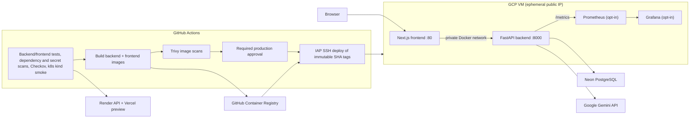

# CareerOps deployment architecture

Production is designed for the existing GCP VM. Render and Vercel are used
only by the `dev` deployment path. The current live state must be verified
before describing the VM as deployed.

The deployment sequence reflects the hosting path: OCI was explored first
for a VM deployment, GCP is now selected because there is an existing VM and
Terraform setup, and Render remains the managed development backend. The
production approval separates image validation from the live release; the
separate Terraform approval protects infrastructure changes.
