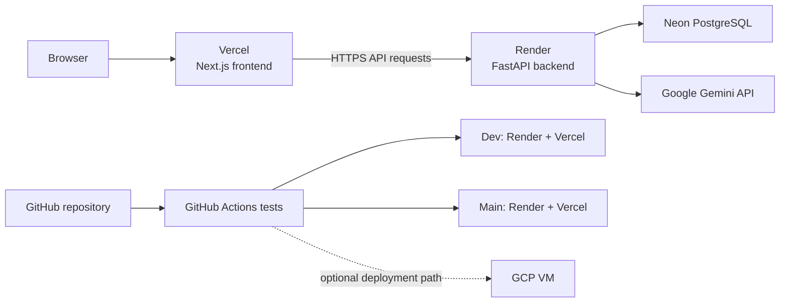
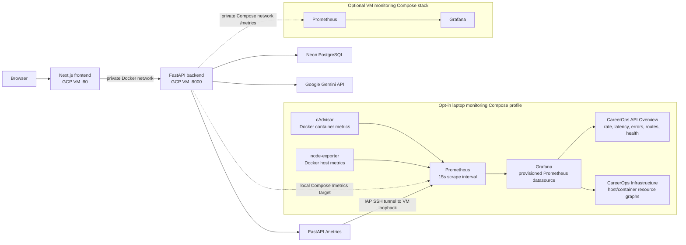
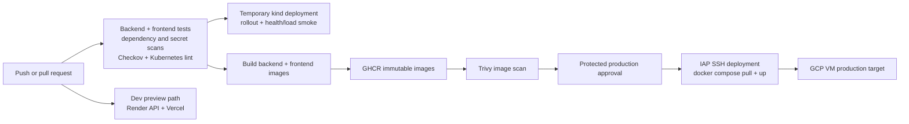

# CareerOps architecture and release flow

This document distinguishes the earlier documented hosting design from the
current checked-in configuration. Diagrams describe repository configuration,
not proof that an external service is currently live.

## Earlier documented design: Render and Vercel

The earlier deployment documentation described Render as the always-on API
host and Vercel as the frontend host. GCP was an optional VM deployment.

This is the earlier documented target, not a claim that those deployments
were live or that the old workflow deployed every service on every branch.

## Current application architecture

The current configured production target is the existing GCP VM. The
Next.js frontend and FastAPI backend communicate over a private Docker
network. The backend uses Neon PostgreSQL and Google Gemini. Monitoring is
implemented as opt-in Docker Compose stacks: a laptop stack for local and
production monitoring, and a separate optional VM stack. The laptop
Prometheus reaches the VM's loopback-only metrics endpoint through an IAP SSH
tunnel. Grafana is provisioned with Prometheus and the two checked-in
CareerOps dashboards.

### Implemented observability components

The monitoring services and dashboard definitions are checked into the
repository and provisioned at startup:

- Root `docker-compose.yml` provides the opt-in `monitoring` profile with
  Prometheus, Grafana, cAdvisor, and node-exporter. Prometheus and Grafana web
  ports are bound to `127.0.0.1`.
- `monitoring/prometheus/prometheus.yml` configures the local scrape jobs for
  the local API, production API tunnel, cAdvisor, node-exporter, and
  Prometheus itself, with a 15-second scrape interval.
- `docker/grafana/provisioning/` provisions the Prometheus datasource and
  dashboard provider. The provisioned dashboards are
  [CareerOps API Overview](../docker/grafana/dashboards/careerops-overview.json)
  (**HTTP requests per second**, **p50/p95/p99 request latency**, **5xx error
  rate**, **requests by status**, **requests by route and method**,
  **in-progress requests**, and **API target health**) and
  [CareerOps Infrastructure](../docker/grafana/dashboards/careerops-infrastructure.json)
  (**host CPU, memory, filesystem, disk and network**; **per-container CPU,
  working-set memory, memory-limit utilization and network**; **out-of-memory
  events**, **CPU throttling**, and **target health**). The graphs use
  FastAPI instrumentation metrics (`http_requests_total`,
  `http_request_duration_seconds_bucket`, `http_requests_inprogress`),
  node-exporter metrics (`node_*`), cAdvisor metrics (`container_*`), and
  Prometheus's `up` series for scrape status.
- `monitoring/docker-compose.yml` and
  `monitoring/prometheus/prometheus.production.yml` provide a separate
  optional VM-side stack that scrapes the backend over the private Compose
  network. The standard application deployment does not start this stack.

The laptop dashboards are available at [Grafana](http://localhost:3001) and
Prometheus targets at [localhost:9090/targets](http://localhost:9090/targets)
when the local monitoring profile is running. A dashboard being provisioned
does not imply that every target is online: the local API requires the local
application stack, and the production API requires the IAP tunnel. On Windows
with Docker Desktop, node-exporter reports the Docker Linux VM, not native
Windows host performance counters. See the root [README](../README.md) for
startup instructions and dashboard links.

## Current release flow

GitHub Actions runs tests and security/configuration checks, validates
Kubernetes manifests in a temporary kind cluster, and builds the frontend
and backend images. Images are published to GHCR and scanned before the
protected production approval. The approved release is deployed to the GCP
VM over IAP SSH. Kubernetes is validated in CI; it is not the production
runtime.

The GCP VM is the configured production runtime; its live state must be
verified independently. The Terraform AWS and Azure modules are disabled by
default. Terraform infrastructure changes have a separate approval path
from application releases.
