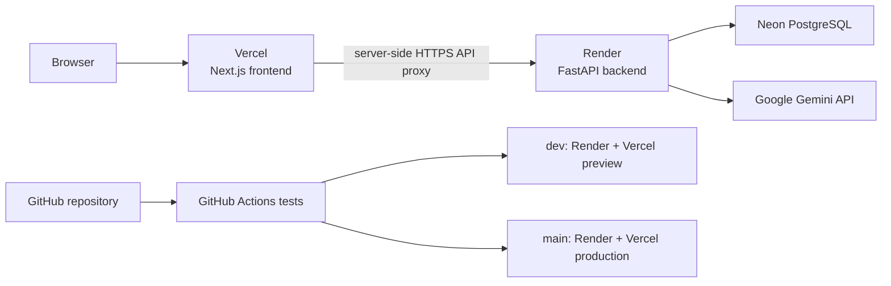
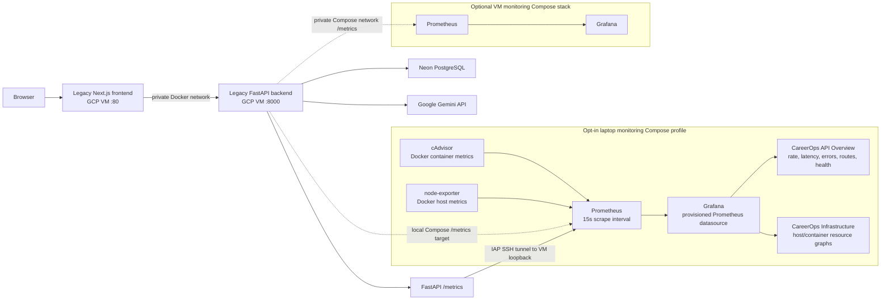
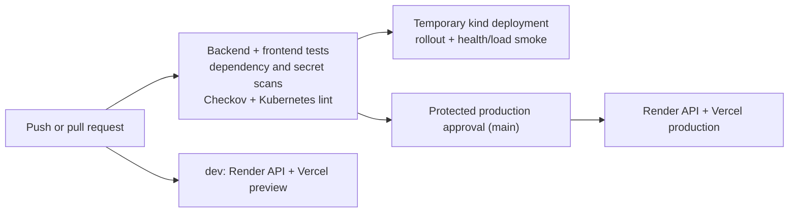

# CareerOps architecture and release flow

Diagrams describe repository configuration, not proof that an external service
is currently live.

## Current application architecture

The `main` branch deploys the Next.js frontend to Vercel and the FastAPI
backend to Render. The `dev` branch targets development/preview services.
Vercel's server-side API route proxies requests to the matching Render backend
over HTTPS. The backend uses Neon PostgreSQL and Google Gemini. GCP VM
application deployment is paused because the linked billing account is closed;
pausing CI does not stop or delete existing GCP resources.

## Optional legacy VM monitoring

Monitoring is implemented as opt-in Docker Compose stacks. The laptop
Prometheus can monitor a legacy VM through an IAP SSH tunnel only if that VM
remains available; this is not part of the Render/Vercel release path.
Grafana is provisioned with Prometheus and the two checked-in CareerOps
dashboards.

### Implemented observability components

The monitoring services and dashboard definitions are checked into the
repository and provisioned at startup:

- Root `docker-compose.yml` provides the opt-in `monitoring` profile with
  Prometheus, Grafana, cAdvisor, and node-exporter. Prometheus and Grafana web
  ports are bound to `127.0.0.1`.
- `monitoring/prometheus/prometheus.yml` configures the local scrape jobs for
  the local API, production API tunnel, cAdvisor, node-exporter, and
  Prometheus itself, with a 15-second scrape interval.
- `docker/grafana/provisioning/` provisions the Prometheus datasource and
  dashboard provider. The provisioned dashboards are
  [CareerOps API Overview](../docker/grafana/dashboards/careerops-overview.json)
  (**HTTP requests per second**, **p50/p95/p99 request latency**, **5xx error
  rate**, **requests by status**, **requests by route and method**,
  **in-progress requests**, and **API target health**) and
  [CareerOps Infrastructure](../docker/grafana/dashboards/careerops-infrastructure.json)
  (**host CPU, memory, filesystem, disk and network**; **per-container CPU,
  working-set memory, memory-limit utilization and network**; **out-of-memory
  events**, **CPU throttling**, and **target health**). The graphs use
  FastAPI instrumentation metrics (`http_requests_total`,
  `http_request_duration_seconds_bucket`, `http_requests_inprogress`),
  node-exporter metrics (`node_*`), cAdvisor metrics (`container_*`), and
  Prometheus's `up` series for scrape status.
- `monitoring/docker-compose.yml` and
  `monitoring/prometheus/prometheus.production.yml` provide a separate
  optional VM-side stack that scrapes the backend over the private Compose
  network. The standard application deployment does not start this stack.

The laptop dashboards are available at [Grafana](http://localhost:3001) and
Prometheus targets at [localhost:9090/targets](http://localhost:9090/targets)
when the local monitoring profile is running. A dashboard being provisioned
does not imply that every target is online: the local API requires the local
application stack, and the legacy VM API requires the IAP tunnel. On Windows
with Docker Desktop, node-exporter reports the Docker Linux VM, not native
Windows host performance counters. See the root [README](../README.md) for
startup instructions and dashboard links.

## Current release flow

GitHub Actions runs tests and security/configuration checks, validates
Kubernetes manifests in a temporary kind cluster, and then pauses `main`
deployments at the protected production environment before triggering Render
and Vercel. The GCP image publishing and VM deployment jobs are paused.
Kubernetes is validated in CI; it is not the production runtime.

The Render/Vercel service configuration and live status must be verified
independently. Terraform AWS and Azure modules remain disabled by default.
GCP Terraform import/apply are separate manual operations, not part of
application releases, and require an active billing account for their remote
state backend.
