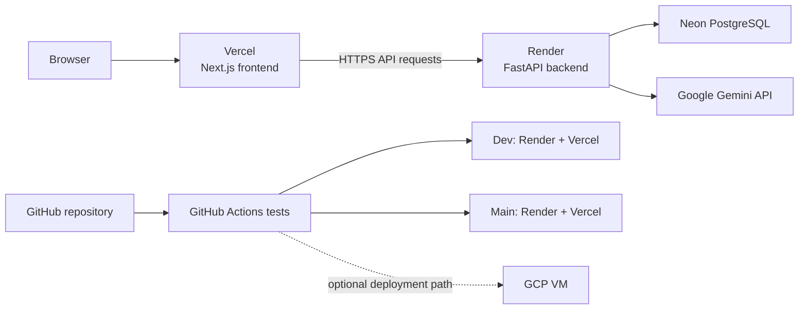
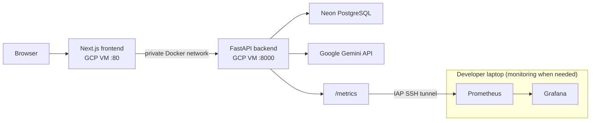
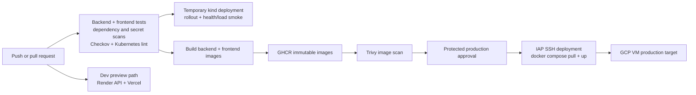

# CareerOps architecture and release flow

This document distinguishes the earlier documented hosting design from the
current checked-in configuration. Diagrams describe repository configuration,
not proof that an external service is currently live.

## Earlier documented design: Render and Vercel

The earlier deployment documentation described Render as the always-on API
host and Vercel as the frontend host. GCP was an optional VM deployment.

This is the earlier documented target, not a claim that those deployments
were live or that the old workflow deployed every service on every branch.

## Current application architecture

The current configured production target is the existing GCP VM. The
Next.js frontend and FastAPI backend communicate over a private Docker
network. The backend uses Neon PostgreSQL and Google Gemini. Monitoring is
an opt-in local stack; Prometheus reaches the VM's loopback-only metrics
endpoint through an IAP SSH tunnel.

## Current release flow

GitHub Actions runs tests and security/configuration checks, validates
Kubernetes manifests in a temporary kind cluster, and builds the frontend
and backend images. Images are published to GHCR and scanned before the
protected production approval. The approved release is deployed to the GCP
VM over IAP SSH. Kubernetes is validated in CI; it is not the production
runtime.

The GCP VM is the configured production runtime; its live state must be
verified independently. The Terraform AWS and Azure modules are disabled by
default. Terraform infrastructure changes have a separate approval path
from application releases.
